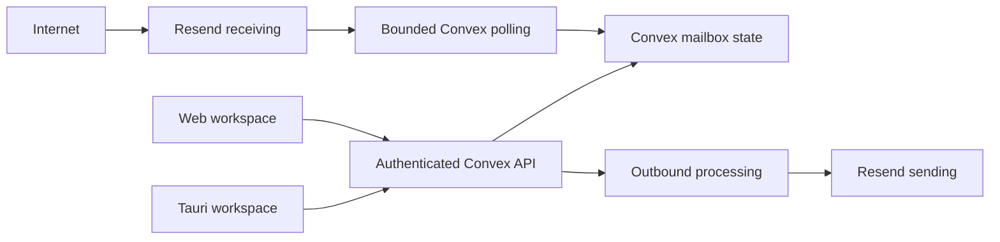

# Architecture

## Product boundary

The only pilot mailbox is `notify@uncap.us`. Resend is the send/receive provider. Convex owns application state. Clerk supplies authenticated user identity. The browser and Tauri clients use the same workspace and backend access rules.

There are no AI classifiers or assistants, external inbox adapters, or self-operated SMTP services in the active architecture.

## Mail paths

Polling runs finite batches on a schedule and returns; it must not start an endless listener. Provider message identifiers are deduplicated within the configured Resend account namespace. Retries must preserve the same message identity and outbound idempotency key.

## Ownership and setup

`api.mail.bootstrap({})` creates the fixed pilot domain and mailbox idempotently for the configured owner. `CLERK_JWT_ISSUER_DOMAIN` configures the token issuer. `HUSTLEMAIL_OWNER_TOKEN_IDENTIFIER` selects the exact authenticated identity. The alternative `HUSTLEMAIL_OWNER_EMAIL` requires a verified matching identity email. An unconfigured installation must expose setup state rather than letting the first visitor claim the mailbox.

Provider domain registration is separate from application bootstrap. The CLI can inspect the registered domain and show a creation plan. Explicit `provision --apply` creates a missing domain through the official Resend CLI. DNS changes remain an explicit operator step, using the exact records returned by Resend.

## Configuration contract

`mail.config.ts` accepts a literal-only default export, optionally wrapped in `defineMailConfig`. The reader rejects executable expressions, spreads, computed keys, unknown fields and inline credentials. `config export` and `config import` transfer normalized JSON and plan or apply local file changes only. They do not deploy Convex functions or mutate provider accounts.

The portable schema permits future domain/box definitions, but current operational commands enforce `uncap.us`, the `notify` box and a 10-second interval. A broader configuration requires an intentional backend scope change. Bootstrap does not import this file: it fixes the mailbox display name to `Notifications`, and outbound processing currently uses the mailbox address without applying `outbound.fromName`.

## Verification boundary

Provider registration, provider DNS verification, successful backend processing and successful delivery visible in the client are different observations. A Resend send response proves acceptance by Resend; it does not prove delivery. See [validation](docs/VALIDATION.md) for evidence and remaining platform checks.
